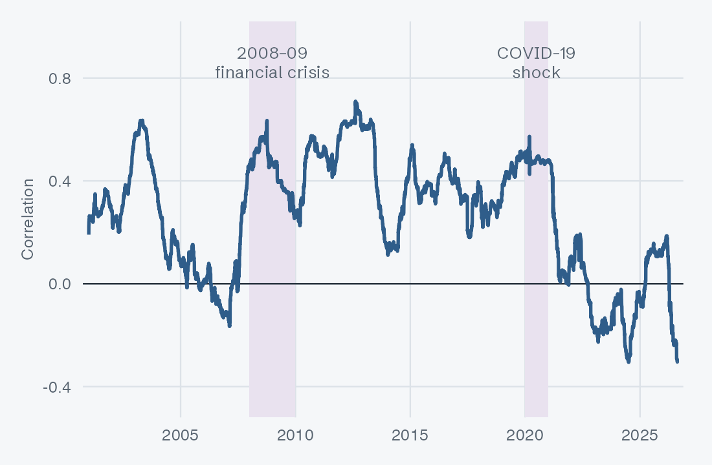

```{=html}
<section class="hero">
  <div>
    <h1>For two decades, stocks and bond yields rose and fell together. Since 2022, they haven't.</h1>
    <p class="hero-intro">I'm Isai Quiñones, a data science and math/CS senior at Dominican University with a minor in finance, graduating May 2027 and looking for full-time data science roles. I measured this shift in R using 26 years of S&amp;P 500 and Treasury data.</p>
    <div class="hero-links">
      <a class="primary" href="posts/Stock-Bond/index.html">Read the analysis</a>
      <a href="https://www.linkedin.com/in/isai-quinones-a147b42b8">LinkedIn</a>
      <a href="https://github.com/iquinones2">GitHub</a>
      <a href="mailto:iq765019@gmail.com">Email</a>
    </div>
  </div>
  <figure>
    <a href="posts/Stock-Bond/index.html">
      
    </a>
    <figcaption>Rolling 250-day correlation between daily S&amp;P 500 returns and daily changes in the 10-year Treasury yield. Shaded: 2008–09 financial crisis, 2020 COVID-19 shock. Data: Yahoo Finance, FRED.</figcaption>
  </figure>
</section>

<section class="work">
  <h2>Work</h2>
  <a class="featured" href="posts/Stock-Bond/index.html">
    <div class="featured-title">U.S. stock returns and Treasury yields: a statistical analysis, 2000–2026</div>
    <p>Regression and correlation analysis of daily S&amp;P 500 returns against 10-year Treasury yield changes. Yield changes explain 8% of return variation across the full period, rising to 15% in the 2008–09 financial crisis and 23% during the 2020 COVID-19 shock.</p>
    <span class="meta">Built in R with quantmod, fredr and ggplot2. August 2026.</span>
  </a>
</section>
```

::: {#work}
:::
