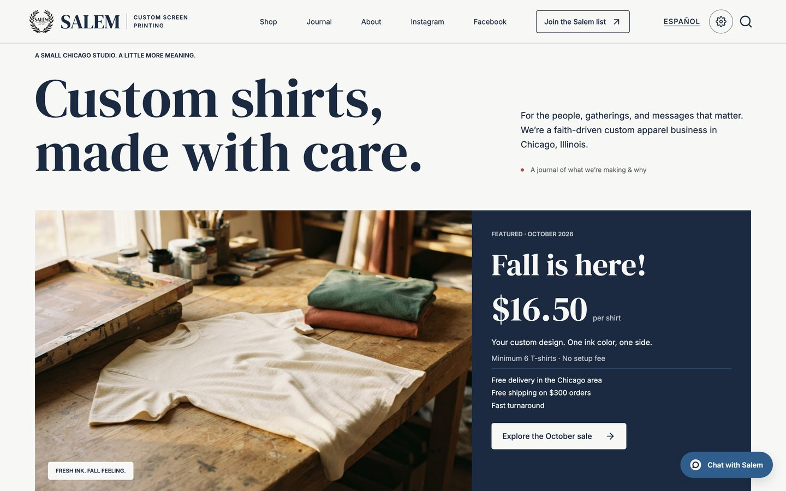
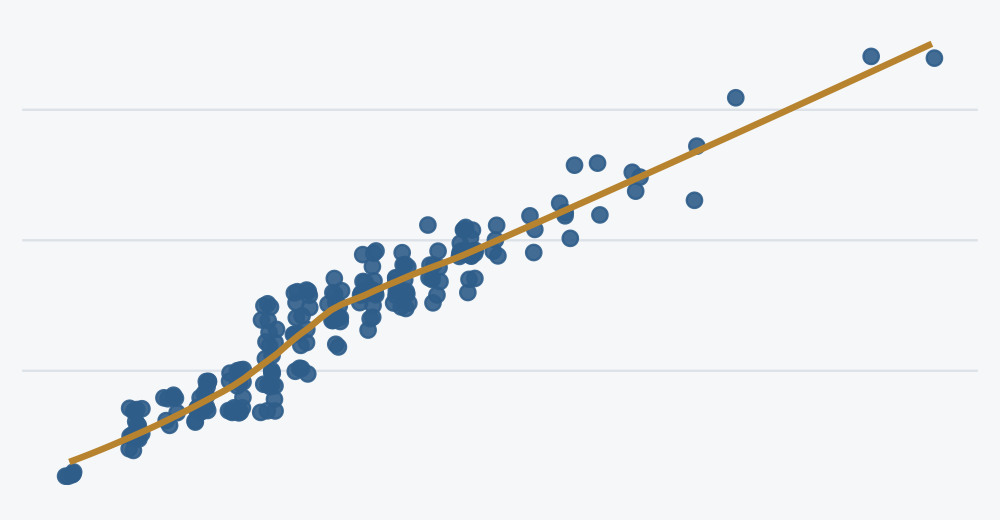

```{=html}
<section class="band band-paper column-screen">
  <div class="wrap hero">
    <div class="hero-copy">
      <p class="status"><span class="dot" aria-hidden="true"></span>Open to <span class="d-only">full-time </span>data science roles · Summer 2027</p>
      <p class="kicker">Data Science <span aria-hidden="true">·</span> Finance <span aria-hidden="true">·</span> Chicago</p>
      <h1>I turn market and institutional data into clear decisions.</h1>
      <p class="lede">Data science senior at Dominican University with a minor in finance. I build pipelines in Python, SQL and Snowflake, and statistical analyses in R that people can actually read.</p>
      <div class="btn-row">
        <a class="btn btn-solid" href="#work">See my work <span aria-hidden="true">→</span></a>
        <a class="btn btn-outline" href="files/Isai-Quinones-Resume.pdf" target="_blank" rel="noopener">Download résumé</a>
      </div>
    </div>

    <div class="panel chart-card">
      <div class="chart-card-head">
        <span class="tag">Featured analysis</span>
        <span class="mono-meta">2000 – 2026</span>
      </div>
      <a class="chart-card-title" href="posts/Stock-Bond/index.html">For two decades stocks and bond yields moved together. Since 2022, they haven't.</a>
      <a class="chart-frame" href="posts/Stock-Bond/index.html">
        
      </a>
      <p class="chart-caption">Rolling 250-day correlation, S&amp;P 500 returns vs. 10-yr Treasury yield changes. Data: Yahoo Finance, FRED.</p>
    </div>
  </div>
</section>

<section class="band band-white band-rule column-screen" aria-label="At a glance">
  <div class="wrap stats">
    <div><strong>26 years</strong><span>of daily S&amp;P 500 and Treasury data modeled in R</span></div>
    <div><strong>4,000 students</strong><span>in the mock Snowflake campus database behind my Datatelligent dashboards</span></div>
    <div><strong>R<sup>2</sup> = 0.23</strong><span>peak explanatory power, found during the 2020 COVID shock</span></div>
    <div><strong>May 2027</strong><span>B.S. Data Science, minor in Finance · Dominican University</span></div>
  </div>
</section>

<section class="band band-paper column-screen" id="work">
  <div class="wrap">
    <div class="section-head">
      <div>
        <p class="kicker">01 — Selected work</p>
        <h2>Projects with measurable results</h2>
      </div>
      <a class="arrow-link" href="https://github.com/iquinones2">All code on GitHub <span aria-hidden="true">→</span></a>
    </div>

    <article class="panel featured">
      <div class="featured-viz" role="img" aria-label="Bar chart of the correlation between S&amp;P 500 returns and 10-year yield changes: 0.29 over 2000–2026, 0.39 in the 2008–09 financial crisis, 0.48 in the 2020 COVID-19 shock.">
        <p class="mono-meta upper">Correlation, S&amp;P 500 returns vs 10-yr yield changes</p>
        <div class="bars" aria-hidden="true">
          <div class="bar-col"><span class="bar-val">0.29</span><span class="bar b-full" style="--h:0.29"></span><b>2000-2026</b><small>Full period</small></div>
          <div class="bar-col"><span class="bar-val">0.39</span><span class="bar b-crisis" style="--h:0.39"></span><b>2008-09</b><small>Financial crisis</small></div>
          <div class="bar-col"><span class="bar-val">0.48</span><span class="bar b-covid" style="--h:0.48"></span><b>2020</b><small>COVID-19 shock</small></div>
        </div>
      </div>
      <div class="featured-body">
        <div class="tags"><span class="tag">R · Statistics</span><span class="tag">Finance</span><span class="tag">Fall Mini Expo 2026</span></div>
        <h3>U.S. stock returns and Treasury yields: a statistical analysis, 2000-2026</h3>
        <p>Regressed ~6,600 days of S&amp;P 500 returns on 10-year Treasury yield changes to measure how the stock-bond link shifts in a crisis.</p>
        <div class="tiles">
          <div><strong>8%</strong><span><span class="d-only">variance explained, </span>full period</span></div>
          <div><strong>15%</strong><span>2008-09<span class="d-only"> financial crisis</span></span></div>
          <div><strong>23%</strong><span><span class="d-only">2020 </span>COVID-19<span class="d-only"> shock</span></span></div>
        </div>
        <div class="btn-row">
          <a class="btn btn-solid" href="posts/Stock-Bond/index.html">Read the analysis <span aria-hidden="true">→</span></a>
          <a class="btn btn-outline" href="https://github.com/iquinones2/R-Data-Science-Portfolio/blob/master/posts/Stock-Bond/index.qmd">View R code</a>
        </div>
        <p class="mono-meta">Built with R, quantmod, fredr, ggplot2</p>
      </div>
    </article>

    <div class="project-grid">
      <article class="panel project">
        <a class="project-preview preview-shot" href="posts/Salem-Web-Blog/Salem.html" tabindex="-1" aria-hidden="true">
          
        </a>
        <div class="project-body">
          <span class="tag">Web · Quarto</span>
          <h3>Salem: website for a local screen-printing business</h3>
          <p>Designed in Figma and shipped on Quarto + GitHub Pages; now adding a Google Sheets subscribe form and email newsletter.</p>
          <a class="arrow-link" href="posts/Salem-Web-Blog/Salem.html">Read the case study <span aria-hidden="true">→</span></a>
        </div>
      </article>

      <article class="panel project">
        <a class="project-preview preview-plot" href="posts/cool_ggplot_work/index.html" tabindex="-1" aria-hidden="true">
          <span class="mono-meta">ggplot2 · geom_point + geom_smooth</span>
          
        </a>
        <div class="project-body">
          <span class="tag">R · ggplot2</span>
          <h3>R graphs: lessons from an R for Data Science intensive</h3>
          <p>Notes from a week-long R for Data Science course: a fuel-economy scatterplot, improved with a trend line and clear labels.</p>
          <a class="arrow-link" href="posts/cool_ggplot_work/index.html">See the charts <span aria-hidden="true">→</span></a>
        </div>
      </article>

      <article class="panel project">
        <a class="project-preview preview-code" href="https://github.com/iquinones2/ThreeLayerAPPCarSales" tabindex="-1" aria-hidden="true">
          <span class="win"><i></i><i></i><i></i><span>SalesController.cs</span></span>
<pre><span class="k">public class</span> <span class="t">SalesController</span> : Controller
{
  <span class="k">private readonly</span> <span class="t">ISalesRepo</span> _repo;
  <span class="k">public</span> <span class="t">IActionResult</span> <span class="f">Index</span>()
    =&gt; View(_repo.GetAll());
  <span class="a">[HttpPost]</span>
  <span class="k">public</span> <span class="t">IActionResult</span> <span class="f">Create</span>(Sale s)
}</pre>
        </a>
        <div class="project-body">
          <span class="tag">C# · SQL Server</span>
          <h3>ASP.NET MVC sales app</h3>
          <p>A multi-layer MVC web app with full CRUD against SQL Server, built to practice clean data-access layers.</p>
          <a class="arrow-link" href="https://github.com/iquinones2/ThreeLayerAPPCarSales">View on GitHub <span aria-hidden="true">→</span></a>
        </div>
      </article>
    </div>
  </div>
</section>

<section class="band band-white column-screen" id="experience">
  <div class="wrap split">
    <div>
      <p class="kicker">02 — Toolkit</p>
      <h2>What I work with</h2>
      <h4 class="chip-label">Languages</h4>
      <ul class="chip-list"><li>Python</li><li>R</li><li>SQL</li><li>C#</li><li>JavaScript</li><li>HTML/CSS</li></ul>
      <h4 class="chip-label">Data &amp; analytics</h4>
      <ul class="chip-list"><li>Snowflake</li><li>Statistics</li><li>ggplot2</li><li>quantmod</li><li>Excel</li><li>SAS</li></ul>
      <h4 class="chip-label">Tools</h4>
      <ul class="chip-list"><li>Quarto</li><li>Git/GitHub</li><li>Figma</li><li>VS Code</li></ul>
    </div>
    <div>
      <p class="kicker">03 — Experience</p>
      <h2>Where I've applied it</h2>
      <ol class="xp">
        <li><span class="when">Oct – Dec 2026</span><div><p class="role"><b>Marketing &amp; Community Engagement Intern</b> <span class="sep">·</span> Digital Leaders Now</p><p>Audited two nonprofit websites for broken links, outdated content and donation gaps.</p></div></li>
        <li><span class="when">Aug 2026 – now</span><div><p class="role"><b>Web Developer (Volunteer)</b> <span class="sep">·</span> Salem Custom Screen Printing</p><p>Designed and shipped the business site; wiring a subscribe form to Google Sheets.</p></div></li>
        <li><span class="when">Sep 2025 – Apr 2026</span><div><p class="role"><b>Solutions Engineer Intern</b> <span class="sep">·</span> Datatelligent</p><p>Built Python and SQL extraction workflows on a mock 4,000-student Snowflake database and the platform's first interactive dashboards on retention and academic success.</p></div></li>
        <li><span class="when">Summer 2024</span><div><p class="role"><b>Quality Control &amp; Assembly</b> <span class="sep">·</span> Sloan Valve</p><p>Quality checks and assembly on a manufacturing line.</p></div></li>
      </ol>
    </div>
  </div>
</section>

<section class="band band-navy column-screen" id="contact">
  <div class="wrap contact">
    <p class="kicker">04 — Contact</p>
    <h2>Hiring for a data science or analytics role?</h2>
    <p>I graduate in May 2027 and can start that summer. Send me a note and I'll get back to you quickly.</p>
    <div class="btn-row">
      <a class="btn btn-light" href="mailto:iq765019@gmail.com">Email me <span aria-hidden="true">→</span></a>
      <a class="btn btn-ghost" href="https://www.linkedin.com/in/isai-quinones-a147b42b8"><i class="bi bi-linkedin" aria-hidden="true"></i> Connect on LinkedIn</a>
    </div>
  </div>
</section>
```
