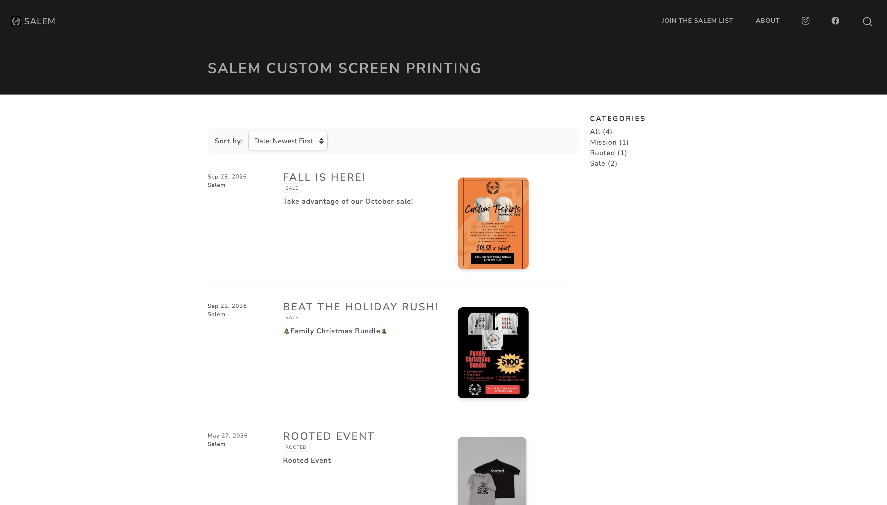

{fig-alt="Screenshot of the Salem blog homepage"}

## Overview

Salem Custom Screen Printing is a small t-shirt screening business, and I'm building its website as a **Small Business Digital Growth Initiative**. The site is a blog-style home for the business's designs, sales, and events, and it's live here: [Salem Blog](https://iquinones2.github.io/Salem-Blog/).

## More Than a Client

This isn't a paid job, and the business owner isn't just a client to me. I chose to take this on because I want to see Salem grow, and because I wanted to build something real for someone I care about. That also means we talk openly: the owner tells me what the business needs, I translate it into the site, and I show progress along the way so the project stays tied to what actually matters to them.

## The Problem

Salem needed a stronger online presence to promote the brand and keep customers coming back. Designs, sales, and events were shared in conversations and photos, with no central place for people to see what Salem offers.

## What I've Built So Far

- **A live, branded website** built with Quarto and hosted on GitHub Pages, featuring Salem's logo and a clean homepage.
- **A blog with four posts**: the business's mission, a recap of the Rooted event, a Family Christmas Bundle sale, and an October sale.
- **Organization for visitors**: posts are tagged by category (Mission, Rooted, Sale) and can be sorted by date or title.
- **An About page** and a **"Join the Salem list" page** where visitors can sign up for updates.
- **Social links** to Salem's Instagram and Facebook.
- **A complete Solution Design Worksheet** mapping the full system: pages, data, automations, AI features, third-party services, hosting, a system diagram, and a step-by-step walkthrough of the subscriber flow.

I started the project in Posit Cloud and moved it to **VS Code with Git and GitHub**, so I can version my work and push updates directly to the live site.

{fig-alt="Screenshot of a Salem design page"}

## My Role

I'm the sole developer and maintainer. I handle the design, the code, the publishing, and all communication with the business owner, from gathering content to showing progress and getting feedback.

## Challenges and What I Learned

- **Moving from Posit Cloud to VS Code**
- **Turning the owner's needs into a plan:** Working through the design worksheet forced me to ask what the business actually needs, such as customer contact info for deals and news, rather than just what would be fun to build.

## What's Next

Based on my design, the next steps are:

1.  **Email subscriptions with automation:** When someone subscribes, an automation will save their info to a Google Sheet, add them to a newsletter list, send a welcome email, and notify the owner. Every email will include an unsubscribe link, and new blog posts will be emailed automatically through the site's RSS feed.
2.  **AI-powered helpers:** A customer FAQ assistant (minimum orders, pricing, how to order) and a quote assistant that turns a plain-English request into a readable order.
3.  **Customization and ordering:** Letting customers browse and customize shirts, with payment, and eventually a drag-and-drop designer.
4.  **Social media integration** and an expanded page structure as the library of designs and events grows.

## Links

- Live site: [iquinones2.github.io/Salem-Blog](https://iquinones2.github.io/Salem-Blog/)
- Repository: [github.com/iquinones2/Salem-Blog](https://github.com/iquinones2/Salem-Blog)